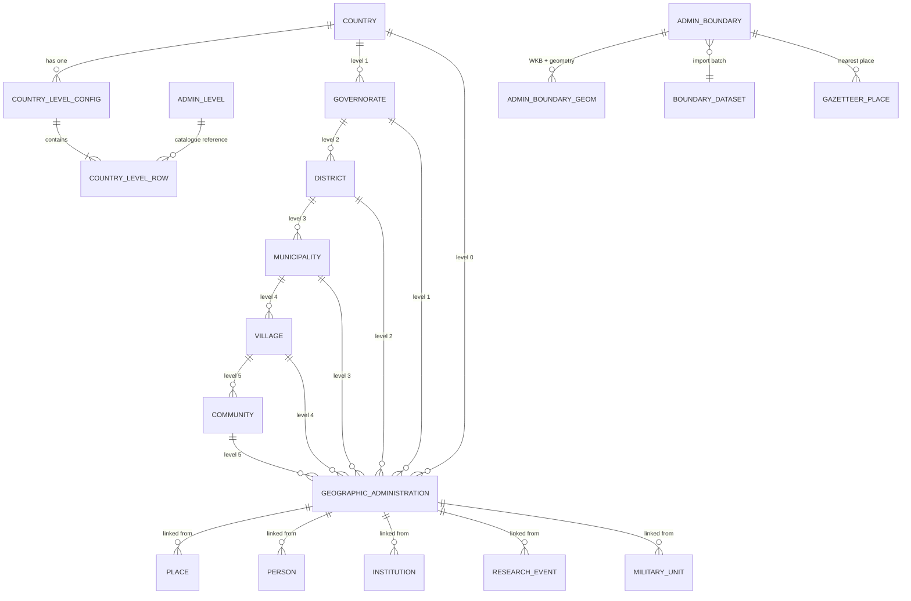

# 4. Geographic hierarchy & DocTypes

## 4.1 Data model



Two different ideas coexist on purpose:

* **Level documents** (`Governorate`, `District`, …) are the authoritative
  registry. They carry the country code chain, the ancestry fields and the
  links other DocTypes use (`Place.governorate`, `Person.country`, …).
* **`Geographic Administration`** is a *hub*: one immutable row per distinct
  chain (`GA:Iraq/IQ-BG/IQ-BG-KR`), so any record can point "somewhere" with a
  single Link and an optional polygon.

Boundaries live in `Admin Boundary` (one row per polygon/feature, with a WKB
hex payload and a link to its `Boundary Dataset`). The optional PostGIS table
`Admin Boundary Geom` mirrors the geometry for indexed `ST_Contains`.

## 4.2 DocTypes and key fields

| DocType | Naming | Key fields | Purpose |
|---|---|---|---|
| `Admin Level` | `field:level_key` | `level` (0–5, unique), `level_key`, `doctype_name`, `prefix`, `default_label_en/ar`, `parent_level`, `sort_order`, `is_optional` | Global catalogue; UI/report metadata |
| `Country Level Config` | `field:country` | `country` (unique), `hierarchy_depth`, `levels[]`, `notes`, `source_reference` | Per-country depth, active flags, labels |
| `Country Level Row` | child | `level`, `level_key`, `is_active`, `label_en`, `label_ar`, `sort_order`, `skip_reason` | One row per level per country |
| `Governorate` … `Community` | `field:code` | `code`, `country`, `governorate`, …, `is_active`, `hierarchy_level`, `ancestry_path`, `ancestry_labels`, `source_kind`, `source_dataset`, coordinates | Level registry (5 DocTypes) |
| `Geographic Administration` | `hash` | full chain + ancestry + geometry + provenance | Linkable hub |
| `Admin Boundary` | `field:code` | `code`, `dataset`, `level`, `parent_pcode`, `geom_wkb_hex`, `precision`, bbox | One boundary feature |
| `Admin Boundary Geom` | child of boundary | `geom` (PostGIS), `precision` | Indexed geometry mirror |
| `Boundary Dataset` | `field:code` | `label_en`, `source`, `license`, `level`, `index_version`, `imported_on` | Provenance + cache version |
| `Gazetteer Place` | `field:geonameid` | names, lat/lon, feature code, population, dataset | Nearest-place fallback |
| `Geo Settings` | singleton | `active_boundary_dataset`, `spatial_backend`, `online_geocoder_enabled`, rate limits, tile/lock flags | Runtime switches |

### `Geographic Administration` schema

| Field | Type | Notes |
|---|---|---|
| `code` | Data, unique | `GA:<segment>/<segment>…`, ≤140 chars; segments are the stored chain values (country document name, then P-codes); SHA-1 suffix when truncated |
| `title` | Data | `ancestry_labels` or the code |
| `name_en`, `name_local` | Data | deepest level's English / Arabic name |
| `source` | Select | `manual`, `core`, `geonames`, `gadm`, `osm`, `online` |
| `is_active` | Check | hidden rows stay linkable; list filters use it |
| `hierarchy_level` | Int | deepest populated level (0–5) |
| `level_key`, `level_label` | Data | catalogue key + English label at that level |
| `ancestry_path` | Data | `Iraq/IQ-BG/IQ-BG-KR` (country document name, then codes) |
| `ancestry_labels` | Small Text | `Iraq › Baghdad › Karkh` |
| `geo_point` | Geolocation | centroid of the deepest linked feature |
| `country` … `community` | Link (6) | the chain itself; inactive levels stay empty |
| `centroid_lat`, `centroid_lng` | Float | numeric copy for reports/exports |
| `boundary` | Link → Admin Boundary | optional polygon |
| `resolution_source` | Select | `manual`, `local`, `online` |
| `resolved_on` | Datetime | last resolution timestamp |
| `notes` | Small Text | free text |

Writing rules (`geo_admin.canonical_payload`):

1. The code is derived only from the populated chain, so the same chain always
   maps to the same row — repeated map clicks never duplicate.
2. `hierarchy_level` is the deepest populated level; links above a skipped level
   are never fabricated.
3. `title`/`ancestry_labels` use the **English** labels from the country's
   configuration; Arabic is rendered on read (`text_ar`), so storage stays
   language neutral.
4. `source` records where the chain came from. `online` is reserved for chains
   that required the external fallback; a `resolution_source="online"` row is
   flagged in the UI and in API `provenance`.

## 4.3 Denormalised ancestry

Every level document (and `Geographic Administration`) stores three redundant
values maintained by `geo_lineage.build_ancestry`:

```
code            IQ-BG-KR
hierarchy_level 2
ancestry_path   Iraq/IQ-BG/IQ-BG-KR
ancestry_labels Iraq › Baghdad › Karkh
```

* The path starts with the **country Link value** (the Country document name,
  normally `Iraq`, not the ISO-2 code), continues with the codes of the linked
  level documents, and includes the record itself. Missing codes fall back to
  the document name. If your Country records are named by code, the path starts
  with that code.
* `MAX_PATH_LENGTH = 500`. Chains longer than that (never in practice) are
  truncated at the last whole segment and flagged `truncated` in the builder's
  return value.
* Rebuild is **dirty-field driven**: `validate` recomputes only when a chain
  field changed, so saving an unrelated field does not touch descendants.
* Moving a node recomputes its own path and schedules its children
  (`siraj_research.geo_lineage.reconcile_plan`), breadth-first, with a hard cap
  of 5 000 nodes per save to keep the request bounded. The backfill command
  handles larger repairs.
* `ancestry_labels` is written with `update_modified=False` during backfills so
  audit fields stay meaningful.

Indexes: `code` (unique), `hierarchy_level`, `ancestry_path` (prefix search),
`is_active`, plus the six Link fields Frappe indexes automatically. On
PostgreSQL the `text_pattern_ops` behaviour of a plain B-tree is sufficient for
`ancestry_path LIKE 'Iraq/IQ-BG/%'`; no expression index is created, because the
path is short and the cardinality is low.

## 4.4 Validation: one gatekeeper, three call sites

All five level controllers delegate to a single function:

```python
# governorate.py (identical in district/municipality/village/community)
from siraj_research.geo_lineage import validate_hierarchy_document

def validate(self):
    validate_hierarchy_document(self)
```

`validate_hierarchy_document(doc)` performs, in order:

| Check | Failure | Message key |
|---|---|---|
| `country` present | hard error | `missing_country` |
| country is a real `Country` and has a code | hard error | `unknown_country` |
| own level active for the country | hard error | `inactive_own_level` |
| a value set on a skipped level | hard error | `inactive_level_populated` |
| parent link belongs to the same country | hard error | `cross_country_parent` |
| chain has no hole (nearest active ancestor missing while an intermediate one is set) | hard error, unless `allow_partial` | `missing_active_ancestor` |
| `code` matches `^[A-Z0-9][A-Z0-9-]{1,39}$` | hard error | `invalid_code` |
| code prefix matches the level | warning | `code_prefix_mismatch` |
| coordinate range / `(0,0)` | warning | `zero_pair`, `out_of_range` |
| ancestry recomputation | silent repair | — |

`allow_partial=True` is set by bulk import and boundary synchronisation, where a
dataset legitimately lacks a parent polygon; those runs record a warning and a
gap, never a fabricated parent. The document flag
`doc.flags.siraj_allow_hierarchy_gaps` is the runtime switch used by
`geo_hierarchy.upsert_level`.

Three enforcement points keep client and server consistent:

1. **Client** — `public/js/siraj-cascade.js` (Desk) and
   `public/js/siraj-cascade-webform.js` (Web Forms, loaded through
   `web_include_js`) set the child-field query so the dropdown only offers records under the selected ancestors, and
   clears descendants when a parent changes. This is convenience only.
2. **Server** — `validate_hierarchy_document` on save (all five DocTypes, plus
   `Geographic Administration`). A crafted POST cannot bypass it.
3. **Bulk paths** — `geo_seeding.import_hierarchy_rows`,
   `geo_hierarchy.sync_boundary_hierarchy`, `geo_bulk.import_*` call the same
   validator with `allow_partial=True`, then write rejections to a CSV report.

List views, reports and web forms reuse the same `ancestor_filters()` helper:

```python
from siraj_research.geo_levels import ancestor_filters
filters = ancestor_filters({"country": "Iraq", "governorate": "IQ-BG"})
# {"country": "Iraq", "governorate": "IQ-BG"}
frappe.get_list("District", filters=filters)
```

Because the helper is the same one the cascade API uses, a report cannot show a
district from another governorate. Web Forms get the same behaviour from
`siraj-cascade-webform.js`: it calls `geo_levels.get_level_config` for the
country, hides inactive levels, clears descendants on change and installs the
same ancestor filters (through `frm.set_query` when the build provides it, or
by setting the Link control's `df.get_query`). Server validation still applies,
so a crafted web-form post cannot create a cross-country chain.

### Cascading behaviour contract

* `GET /api/method/siraj_research.geo_cascade.cascade?field=district&value=…`
* Filters include **only active ancestor fields** for that country.
* Changing a parent returns `clear: ["municipality", "village", "community"]`;
  the JS clears them before rendering options. The server also rejects a save
  whose child does not descend from its parent.
* Options carry `{value, label, label_ar, code}`; labels come from the record,
  the level label from `level_config`.
* An empty parent returns an empty option list and the reason
  `{"reason": "parent_required"}`, never every row in the table.

## 4.5 Coordinate resolution contract

`resolve_location` is the single whitelisted entry point
(`siraj_research.api.geo_resolve.resolve_location`). It is a thin composition of
`display_resolution` (level chain), `geo_admin.ensure_for_values` (hub row) and
`api.throttle.guard` (rate limit).

```http
POST /api/method/siraj_research.api.geo_resolve.resolve_location
Content-Type: application/x-www-form-urlencoded

latitude=33.3152&longitude=44.3661&use_online=0&create_missing=1
```

```json
{
  "ok": true,
  "lat": 33.3152,
  "lon": 44.3661,
  "resolved": true,
  "deepest_level": 1,
  "levels": [
    {"level": 0, "field": "country", "doctype": "Country", "label": "Country",
     "label_ar": "الدولة", "name": "Iraq", "label_en": "Iraq", "code": "IQ",
     "status": "linked", "source": "osm", "confidence": "high"},
    {"level": 1, "field": "governorate", "doctype": "Governorate",
     "label": "Governorate", "label_ar": "المحافظة", "name": "IQ-BG",
     "label_en": "Baghdad", "code": "IQ-BG", "status": "linked",
     "source": "osm", "confidence": "high"},
    {"level": 2, "field": "district", "doctype": "District", "label": "District",
     "label_ar": "القضاء", "name": null, "status": "gap",
     "skip_reason": "not in dataset"}
  ],
  "text_en": "Iraq › Baghdad",
  "text_ar": "العراق › بغداد",
  "gaps": ["district"],
  "warnings": [],
  "provenance": ["postgis", "bbox_prefilter"],
  "on_land": true,
  "ambiguous": false,
  "nearest_place": null,
  "dataset": "OSM-IQ",
  "level_config": {"country": "Iraq", "source": "override", "depth": 5},
  "geographic_administration": "a1b2c3d4e5"
}
```

Contract details:

| Aspect | Behaviour |
|---|---|
| **Input order** | `latitude`, `longitude` (degrees). Strings accepted; non-numeric → `invalid_coordinates` |
| **Range** | lat −90…90, lon −180…180; anything else → `out_of_range` (no clamping) |
| **`(0,0)`** | accepted, warning `zero_pair`, usually `unresolved` |
| **Unresolved** | `ok:false`, `error:"unresolved"`, `unresolved_reason` ∈ `no_dataset`, `offshore`, `no_polygon` — never a fake country |
| **Offshore / outside coverage** | distance to the nearest polygon within `reverse_max_m` (default 5 000 m) → chain + warning `near_boundary`; beyond it → `offshore` |
| **Overlapping polygons** | chosen by dataset `level` then smallest area; `ambiguous:true` when two candidates are within 5 % area difference, both listed in `candidates` |
| **Borders** | a point exactly on a shared edge resolves deterministically to the polygon with the lower `level`, then the lexicographically smaller `code` |
| **Lookup order** | PostGIS `ST_Contains` → PostGIS `ST_DWithin` → Shapely `STRtree` (same two steps) → gazetteer nearest place → optional online fallback (only when `use_online=1` **and** enabled), each step only if the previous produced an incomplete chain |
| **`source="online"`** | Set by `_merge_online` and by `ensure_for_values(resolution_source="online")`; the UI shows a badge, exports keep the marker |
| **Cache** | in-process LRU keyed `(rounded lat 4dp, lon 4dp, fallback mode, create flag)`, 1 024 entries; dropped on restart or when `Boundary Dataset.index_version` changes |
| **Rate limit** | `guard("resolve_location")`, `endpoint_rate_limit_per_min` per user (default 240); batch 30/min; `429 TooManyRequestsError` |
| **Permissions** | requires `read` on `Place`; the hub row is only created with `create` on `Geographic Administration`; returned level rows are filtered with `frappe.has_permission` |
| **Logging** | structured `frappe.logger("siraj.geo")` line per resolution: `{lat, lon, ms, backend, levels, reason}`; no coordinates are logged at INFO for anonymous failures |

Performance target **< 200 ms p95**: one GiST-indexed `ST_Contains` plus a
`ST_DWithin` fallback; the Shapely path uses a cached `STRtree` built from
`Admin Boundary` once per dataset version. Measure with
`bench --site <site> geo benchmark --repeats 50`.

## 4.6 PostGIS schema and backfill

```sql
-- created by: bench geo postgis-init  (idempotent)
ALTER TABLE `tabAdmin Boundary Geom`
  ADD COLUMN geom geometry(Geometry, 4326);

CREATE INDEX idx_siraj_admin_boundary_geom
  ON `tabAdmin Boundary Geom` USING GIST (geom);
```

`Admin Boundary Geom` already exists as a Frappe child table (one row per
`Admin Boundary`, `precision = 'full'`). The backfill copies WKB:

```sql
WITH batch AS (
  SELECT name FROM `tabAdmin Boundary Geom`
  WHERE geom IS NULL AND geom_wkb_hex IS NOT NULL
    AND length(geom_wkb_hex) > 20
  LIMIT 500
)
UPDATE `tabAdmin Boundary Geom` g
SET geom = ST_GeomFromWKB(decode(g.geom_wkb_hex, 'hex'), 4326)
FROM batch WHERE g.name = batch.name;
```

* Chunked (`--batch-size`, default 500) so a 100 k-polygon dataset does not hold
  one huge transaction.
* Resumable: `geom IS NULL` is the cursor; rerunning continues.
* `index_version` on `Boundary Dataset` is bumped after import/backfill, which
  invalidates `_INDEX_CACHE` and the Redis resolution cache.
* No `CREATE EXTENSION` is attempted by the app — an operator does that once per
  database (chapter 1, §1.6). Without the extension, `health()` reports
  `postgis_available: false` and the Shapely path is used.

The resolver's SQL (abridged):

```sql
SELECT b.code, b.level, b.parent_pcode,
       ST_Area(g.geom::geography) AS area_m2
FROM `tabAdmin Boundary Geom` g
JOIN `tabAdmin Boundary` b ON b.name = g.parent
WHERE g.precision = 'full'
  AND ST_Contains(g.geom, ST_SetSRID(ST_MakePoint(%s, %s), 4326))
ORDER BY b.level ASC, area_m2 ASC
LIMIT 5;
```

## 4.7 Seeding procedures

### 4.7.1 Sources and licences

| Source | File format | Levels | Licence / obligation |
|---|---|---|---|
| **Natural Earth** | Shapefile / GeoJSON (`admin_0`, `admin_1`) | 0–1 | Public domain; attribution appreciated |
| **GADM** | GeoJSON/GPKG per country | 0–3 | Free for non-commercial use; **check your licence** before redistribution, attribution required |
| **GeoNames** | `cities500.zip`, `admin1CodesASCII.txt`, `admin2Codes.txt` | gazetteer, 1–2 | CC BY 4.0 — attribution required |
| **OpenStreetMap** | `.osm.pbf` → boundary GeoJSON; `osm-boundaries.com` exports | 1–5 | ODbL 1.0 — attribution + share-alike for derived DBs |
| **OCHA COD / HDX** | CSV with `pcode`, `parent_pcode` | 0–5 | Usually CC BY 3.0 IGO; per-dataset |
| **Operator CSV/GeoJSON** | any of the above shapes | 1–5 | Operator's responsibility |

The `Boundary Dataset` row stores `source` and `license`; the UI shows them next
to the layer. Shipping a dataset in Git requires a compatible licence — the
repository ships **no** polygons, only reference names/codes.

### 4.7.2 Expected input files

Boundary import (`geo_bulk.import_gadm` / `import_osm` /
`setup_region(dataset_code, source_path, level=…)`) expects a GeoJSON
`FeatureCollection` in EPSG:4326 with, per feature:

```json
{
  "type": "Feature",
  "properties": {
    "code": "IQ-BG",
    "name": "Baghdad",
    "name_ar": "بغداد",
    "parent_code": "IQ",
    "level": 1
  },
  "geometry": {"type": "MultiPolygon", "coordinates": [[[[44.2, 33.2], "..."]]]}
}
```

`properties.code`/`name` may be supplied under common aliases (`pcode`, `PCODE`,
`NAME_1`, `shapeName`, …); the parser normalises them. Geometry may be
`Polygon` or `MultiPolygon`; anything else is a rejection with
`unsupported_geometry`.

Tabular import (`bench geo import-csv`, `geo_seeding.parse_hierarchy_csv`)
accepts UTF-8 (BOM tolerated), comma or semicolon delimiters, and these headers
(case-insensitive, aliases from `HEADER_ALIASES`):

| Field | Accepted headers |
|---|---|
| `code` | `code`, `pcode`, `id`, `p_code` |
| `name_en` | `name_en`, `label_en`, `name`, `english_name` |
| `name_local` | `name_local`, `label_ar`, `name_ar`, `local_name`, `arabic_name` |
| `parent_code` | `parent_code`, `parent`, `parent_pcode`, `parent_id` |
| `latitude` / `longitude` | `latitude`/`lat`/`centroid_lat`, `longitude`/`lng`/`lon`/`long`/`centroid_lng` |
| `source` | `source`, `source_kind`, `provenance` |
| `admin_level_type` | `admin_level_type`, `type`, `level_type` |
| `is_active` | `is_active`, `active`, `enabled` |

Example:

```csv
pcode,name,parent_pcode,lat,lon
IQ-BG,Baghdad,IQ,33.3152,44.3661
IQ-BG-KR,Karkh,IQ-BG,33.3000,44.3500
```

Rows are inserted **parent-first**: import level 1 before level 2 so the Link
targets exist. The command validates every row before inserting:

| Rejection reason | Meaning |
|---|---|
| `empty_file` | no data rows |
| `missing_code` / `invalid_code` | code absent or outside `^[A-Za-z0-9][A-Za-z0-9._:-]{0,139}$` |
| `duplicate_code` | same code twice in the file, or already present |
| `missing_name_en` | no English label |
| `invalid_coordinates` | unparsable / out of range / `(0,0)` in a row claiming a point |
| `invalid_geojson`, `unsupported_geometry` | malformed geometry |
| `missing_code_or_name` | GeoJSON feature without either |
| `unknown_parent` | `parent_code` not found (gap; row can be imported with `allow_partial`) |

### 4.7.3 Commands, batching, resume

```bash
cd ~/frappe-bench

# 1. Level catalogue + countries + reference names
bench --site research.local geo seed-levels
bench --site research.local geo seed-core --country IQ

# 2. Boundaries (one call per file/level; each is a Boundary Dataset import)
bench --site research.local execute siraj_research.geo_bulk.import_gadm \
  --kwargs '{"dataset_code":"GADM-IQ","file_path":"/srv/geodata/gadm/IQ.gpkg","level":2}'

bench --site research.local execute siraj_research.geo_bulk.import_osm \
  --kwargs '{"dataset_code":"OSM-IQ","file_path":"/srv/geodata/osm/iq-boundaries.geojson","level":3}'

# 3. Gazetteer (nearest-place fallback)
bench --site research.local execute siraj_research.geo_bulk.import_geonames \
  --kwargs '{"zip_path":"/srv/geodata/geonames/cities500.zip","dataset_code":"GEONAMES-CITIES"}'

# 4. Materialise level documents from the polygons
bench --site research.local execute siraj_research.geo_bulk.sync_boundary_hierarchy \
  --kwargs '{"dataset_code":"GADM-IQ","create_missing":True}'

# 5. Optional PostGIS acceleration
bench --site research.local geo postgis-init
bench --site research.local geo postgis-backfill --dataset GADM-IQ --batch-size 500
```

Every command above prints progress and returns a JSON summary. Long imports can
be resumed by repeating the command with `--offset`; the seeding session writes
`private/offline-cache/<name>-checkpoint.json` (`{"offset": …, "updated_at": …}`)
and `<name>-rejections.csv` (`row,level,code,reason,detail`, capped at 10 000
rows). The checkpoint is written after each batch, so resuming never restarts
from row 0.

`sync_boundary_hierarchy` is the bridge that turns polygons into Link targets:

* parents are processed level by level; a child whose parent polygon is missing
  attaches to the nearest existing active ancestor and records a gap,
* existing documents are updated in place when `code` matches (idempotent),
* `create_missing=False` reports what *would* be created without writing,
* ancestry is rebuilt for every touched node and its subtree.

### 4.7.4 Audit

```bash
bench --site research.local geo audit --fail-on-issues
```

Read-only checks: country present and known, active-level values valid, inactive
levels empty, parent in the same country, ancestry path matching the links,
duplicate codes, orphaned `Geographic Administration` rows. Exit code `1` when
`issues` is non-empty and `--fail-on-issues` is passed, so it can gate a
deployment.

## 4.8 Attaching geography to research records

The v1.2 patch adds a `geographic_administration` Link to seven DocTypes:
`Place`, `Person`, `Institution`, `Research Event`, `Siraj Event`,
`Military Unit`, `Operational Deployment`.

* The Link uses the standard Frappe search; typing a place name searches the
  hub's `title` / `name_en`.
* Saving a record calls `geo_doc_events.auto_fill_hierarchy` (registered in
  `hooks.doc_events.validate` for the seven DocTypes): empty ancestors are filled
  from the linked hub row, explicit values are kept, and a hub row is created
  when the chain is complete enough (`ensure_for_document`).
* If the hub row is deleted, the Link is simply empty on the next save; nothing
  cascades destructively.

That gives reports a single join (`tabPlace.geographic_administration`) instead
of five, while level DocTypes remain the source of truth for names and codes.
