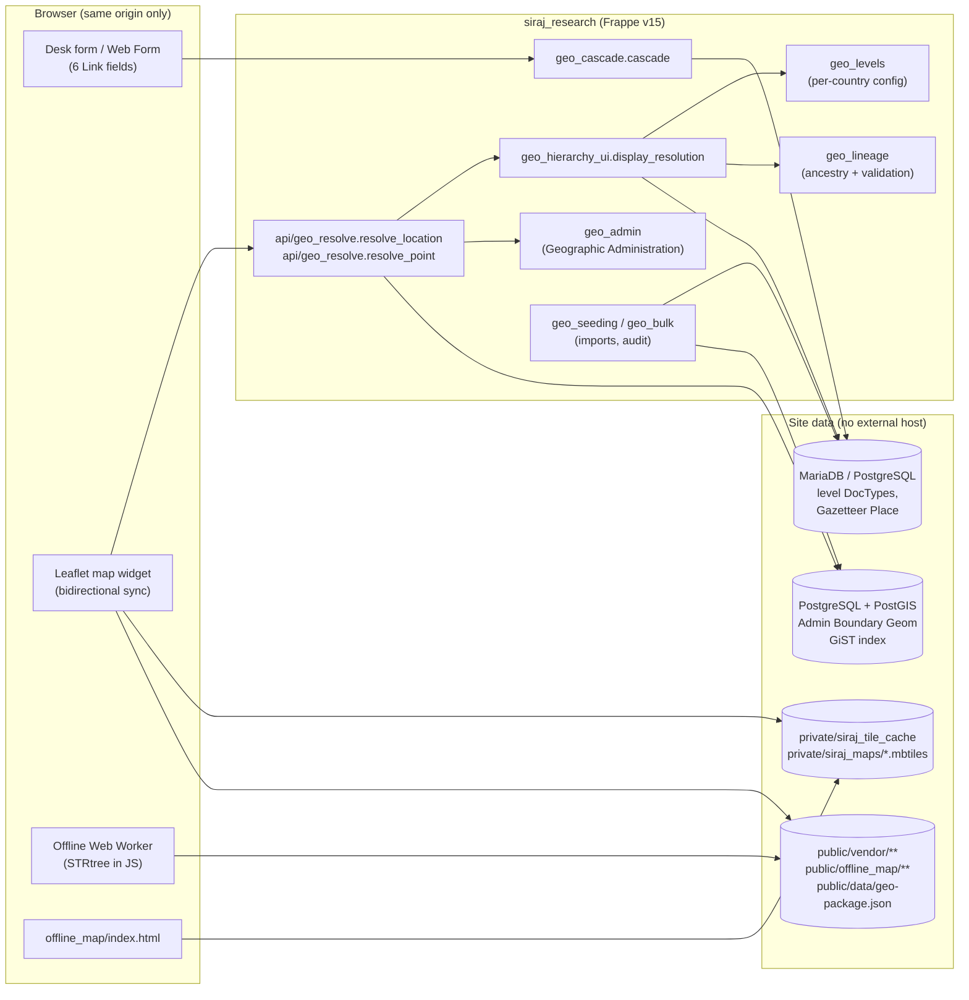

# 6. Verification & deliverables

## 6.1 Architecture overview



Request path for a map click:

1. `siraj-geopoint.js` / map widget debounces the click (250 ms).
2. `POST resolve_location` with `{latitude, longitude, use_online:0}`.
3. `display_resolution` → `geo_hierarchy.resolve_and_link`:
   PostGIS `ST_Contains` (GiST) → `ST_DWithin` → Shapely `STRtree` → gazetteer.
4. Level configuration annotates labels/active flags; `geo_admin` ensures the hub
   row (idempotent code).
5. Response fills the six Link fields, shows gaps as "not used in this country",
   and paints the resolved polygons on the map. Clearing a field clears
   descendants; a manual edit triggers no write-back.

## 6.2 Folder structure (new/changed files in this drop)

```text
siraj_research/
├─ geo_levels.py                 # per-country depth/labels/skips, cache, filters
├─ geo_lineage.py                # ancestry build/repair, validate gatekeeper
├─ geo_admin.py                  # Geographic Administration payload + APIs
├─ geo_postgis.py                # PostGIS schema, backfill, resolve, benchmark
├─ geo_seeding.py                # CSV/GeoJSON import, config seed, audit, GA backfill
├─ offline_verify.py             # sockets blocked + assets/tiles/storage report
├─ api/
│  ├─ geo_resolve.py             # resolve_location / resolve_point / batch / area
│  └─ throttle.py                # per-user fixed-window rate limiter
├─ commands/
│  ├─ __init__.py                # bench command registration
│  └─ geo.py                     # 13 `bench geo …` subcommands
├─ hooks.py                      # after_install, web_include_js, doc_events
├─ setup/
│  ├─ install.py                 # roles, workflow state, core + level seed
│  ├─ uninstall.py               # custom fields + cache cleanup
│  ├─ master_data.py             # reference countries + hierarchy
│  ├─ demo_data.py               # [DEMO] interconnected dataset
│  └─ reference_data/
│     └─ level_configs.json      # IQ/SA/LB/JO/PS/IL configurations
├─ patches/v1_2/
│  ├─ __init__.py
│  └─ add_level_config_and_ancestry.py
├─ public/
│  ├─ js/siraj-cascade-webform.js   # Web Form cascade adapter (new)
│  └─ offline_map/…                 # offline viewer (existing, verified)
└─ siraj_research/doctype/
   ├─ admin_level/                  # new
   ├─ country_level_config/         # new
   ├─ country_level_row/            # new
   ├─ geographic_administration/    # new
   ├─ governorate|district|municipality|village|community/  # validate + fields
   └─ geo_settings/                 # spatial_backend, rate limit fields

tests/
├─ test_geo_levels.py            # config merge, skips, filters, validation
├─ test_geo_lineage.py           # ancestry, reconcile, viewport
├─ test_geo_admin_payload.py     # canonical code/payload, idempotency contract
├─ test_geo_seeding.py           # CSV/GeoJSON parsers, rejections, sessions
├─ test_offline_verification.py  # socket block, asset/CDN scan, report shape
├─ test_geo_contract_schema.py   # field/label contract across app + DocTypes
├─ test_geo_display_contract.py  # text chain skips gaps, API contract
└─ test_webform_cascade.js       # web form filters/clearing (Node)
```

## 6.3 Artifact index

| Artifact | Path | Verified by |
|---|---|---|
| Level configuration engine | `siraj_research/geo_levels.py` | `test_geo_levels.py` (pure) |
| Ancestry + validation | `siraj_research/geo_lineage.py` | `test_geo_lineage.py` (pure) |
| Administration hub | `siraj_research/geo_admin.py` | `test_geo_admin_payload.py` |
| PostGIS acceleration | `siraj_research/geo_postgis.py` | `geo postgis-health` / `benchmark` (bench) |
| Seeding / audit | `siraj_research/geo_seeding.py` | `test_geo_seeding.py` (pure parsers) |
| Offline verifier | `siraj_research/offline_verify.py` | `test_offline_verification.py` |
| Throttle | `siraj_research/api/throttle.py` | contract test + bench 429 check |
| Commands | `siraj_research/commands/geo.py` | `bench geo --help` / audit exit codes |
| DocTypes (4 new, 5 updated) | `siraj_research/siraj_research/doctype/**` | `test_doctype_integrity.py` (807 subtests) |
| Patch | `siraj_research/patches/v1_2/add_level_config_and_ancestry.py` | rerun on a migrated site |
| Reference configs | `siraj_research/setup/reference_data/level_configs.json` | `seed_country_level_configs` report |
| Web Form cascade | `public/js/siraj-cascade-webform.js` | `test_webform_cascade.js` |
| Pins | `requirements.txt`, `requirements-offline.txt` | `pip install --no-index` |
| Docs | this folder | — |

## 6.4 Verification checklist

Run in order. A step that cannot pass yet states why, rather than silently
succeeding.

### A. Unit / static (no bench)

```bash
cd apps/siraj_research
python -m pytest tests/ -q \
  --ignore=tests/test_coordinate_audit.py --ignore=tests/test_default_workflow_state.py \
  --ignore=tests/test_fixture_controllers.py --ignore=tests/test_geo_import.py \
  --ignore=tests/test_master_data.py --ignore=tests/test_test_data.py \
  --ignore=tests/test_treeview.py --ignore=tests/test_visualization.py
# 282 passed, 131 subtests passed

python -m pytest siraj_research/tests/test_doctype_integrity.py -q
# 9 passed, 807 subtests passed

node tests/test_siraj_cascade_core.js
node tests/test_webform_cascade.js
ruff check siraj_research tests
```

The ignored modules require a live Frappe site (`frappe` import, database,
fixtures); they run under `bench --site <site> run-tests --app siraj_research`.

### B. Reference hierarchy (no polygons needed)

After `bench --site <site> geo seed-core`, assert the shipped chain. These
values are exact for `setup/reference_data/*.json` in this repository:

| Coordinate | Expected country | Expected level 1 | Expected deeper reference row (code → label_en) | Expected `ancestry_path` of the deepest row |
|---|---|---|---|---|
| `33.3152, 44.3661` Baghdad | `Iraq` (`IQ`) | `IQ-BG` → **Bagdad** | `IQ-BG-KR-KR` → *Baghdad — Karkh side* (municipality) | `Iraq/IQ-BG/IQ-BG-KR/IQ-BG-KR-KR` |
| `31.9539, 35.9106` Amman | `Jordan` (`JO`) | `JO-AM` → *The Capital Governorate* | `JO-AM-AM-AM-SW` → *Sweifieh* (village) | `Jordan/JO-AM/JO-AM-AM/JO-AM-AM-AM/JO-AM-AM-AM-SW` |
| `24.7136, 46.6753` Riyadh | `Saudi Arabia` (`SA`) | `SA-01` → *Riyadh* (label *Region*) | `SA-01-RY-RY-OL` → *Al-Olaya* (level 4) | `Saudi Arabia/SA-01/SA-01-RY/SA-01-RY-RY/SA-01-RY-RY-OL` |
| `31.5017, 34.4668` Gaza | `Palestine` (`PS`) | `PS-GZA` → *Gaza City Governorate* | `PS-GZA-GZ-GZ-RM-SC` → *Al-Shati (Beach) Camp* (community) | `Palestine/PS-GZA/PS-GZA-GZ/PS-GZA-GZ-GZ/PS-GZA-GZ-GZ-RM/PS-GZA-GZ-GZ-RM-SC` |
| `33.8938, 35.5018` Beirut | `Lebanon` (`LB`) | `LB-BA` → *Beirut* | none — Lebanon depth 3; the reference file has no Beirut municipality | `Lebanon/LB-BA` (chain stops; `village`, `community` inactive) |

Check with the ORM (read-only):

```python
# bench --site research.local console
import frappe
row = frappe.get_doc("Village", "JO-AM-AM-AM-SW")
print(row.country, row.governorate, row.district, row.municipality)
print(row.ancestry_path)
print(row.ancestry_labels)
# Jordan JO-AM JO-AM-AM JO-AM-AM-AM
# Jordan/JO-AM/JO-AM-AM/JO-AM-AM-AM/JO-AM-AM-AM-SW
# Jordan › The Capital Governorate › Amman › Greater Amman › Sweifieh
```

Notes that are data, not bugs:

* `IQ-BG`'s English label is **Bagdad** in the reference file (an accepted
  transliteration), while the demo Place is **Baghdad**. Both are spelled as
  supplied; nothing normalises them.
* Administrative unit rows (`admin_units.json`) intentionally carry **no**
  coordinates — they are names/codes, and coordinates come from polygons.
  Therefore Track B, not Track A, is what resolves a coordinate.

### C. Coordinate → hierarchy with a boundary dataset

Import a dataset (chapter 4), then:

| Input | Expected |
|---|---|
| `resolve_location(33.3152, 44.3661)` | `ok:true`, level 0 = `Iraq`, level 1 = `IQ-BG`; codes/names from **your** dataset; `text_en` = `Iraq › <governorate label>`; `geographic_administration` = `GA:Iraq/IQ-BG…` |
| `resolve_location(31.9539, 35.9106)` | `ok:true`, country `Jordan`, governorate `JO-AM`; deeper levels present only if the dataset has them |
| `resolve_location(0, 0)` | `ok:false`, `error:"unresolved"`, warning `zero_pair` (not "Gulf of Guinea") |
| `resolve_location(91, 44)` | `ok:false`, `error:"out_of_range"`; nothing is clamped |
| `resolve_location(28.5, 49.5)` (Gulf, outside land) | `ok:false`, `unresolved_reason:"offshore"` after the `ST_DWithin`/`reverse_max_m` tolerance fails |
| `resolve_location(33.30, 44.35, use_online=1)` with fallback disabled | identical to the offline result; `provenance` stays free of `online_reverse_geocode`, no network attempt |
| `resolve_location(…, create_missing=0)` | same levels, `geographic_administration: null` when no row exists |

`geo verify-offline` returns `passed:true` only when **all** of: backend,
dataset, lock, assets, tiles, blocked resolution, non-empty chain, no online
provenance. Use `--expect country,governorate` to pin the first two levels.

### D. Performance (targets, measured on your hardware)

```bash
bench --site research.local geo benchmark --repeats 50
# {"dataset":"…","queries":150,"median_ms":…,"p95_ms":…}
bench --site research.local execute \
  siraj_research.geo_cascade.cascade --kwargs '{"field":"district","value":"IQ-BG"}'
```

Acceptance: resolver **p95 < 200 ms** with PostGIS; cascade query **< 300 ms**
per level. Both are single indexed queries plus one level-config cache hit. If
p95 is higher, check that `postgis-backfill` completed (`geo postgis-health` →
`column_exists`, `index_exists`, `stats.with_geometry ≈ boundaries`) and that
`EXPLAIN` shows the GiST index.

The reference texts give no timing guarantees for the Shapely path; it is a
correctness fallback, not a performance path.

### E. Security and correctness of writes

| Check | Expected |
|---|---|
| Anonymous `resolve_location` | `403` (`PermissionError`) — no session, no data |
| `resolve_batch` with 31 calls/min by one user | `429 TooManyRequestsError` after the 30th |
| Crafted save: `district` from another country | `ValidationError` (`cross_country_parent`) |
| Crafted save: value in an inactive level | `ValidationError` (`inactive_level_populated`) |
| Crafted save: missing intermediate while a deeper ancestor is set | `ValidationError` (`missing_active_ancestor`) |
| SQL-ish payload in `latitude` | `invalid_coordinates`; parameters are bound, never interpolated |
| Deleting a `Country Level Config` | levels revert to catalogue defaults on the next request (cache cleared) |
| `bench geo audit --fail-on-issues` on clean data | exit `0`, `issues: []` |

### F. Idempotency and lifecycle

```bash
bench --site research.local install-app siraj_research   # second run
bench --site research.local execute siraj_research.setup.install.after_install
bench --site research.local execute \
  siraj_research.patches.v1_2.add_level_config_and_ancestry.execute
bench --site research.local geo seed-levels
bench --site research.local geo seed-core
bench --site research.local geo audit
```

Expected: no duplicates, no error, identical counts before and after (except
newly created rows on the first run). `after_install` preserves edited
configurations; the patch does not overwrite an existing `Country Level Config`.

Uninstall test on a scratch site: §1.9; afterwards no `siraj_research` DocType
tables remain and the seven `geographic_administration` Custom Fields are gone:

```python
frappe.get_all("Custom Field", filters={"fieldname": "geographic_administration"})  # []
```

### G. Bilingual / RTL

| Check | Expected |
|---|---|
| UI language `ar` | level labels come from `label_ar` (`المحافظة`, `القضاء`, …) and the page renders RTL (Frappe built-in) |
| `text_ar` in `resolve_location` | Arabic chain, separated by ` › ` (Arabic glyphs in RTL context) |
| Missing `label_ar` in a config | falls back to `label_en`, never to the fieldname |
| Arabic-Indic digits in coordinate inputs | accepted by the viewer parser; API expects Latin digits |
| `ancestry_labels` | English by design; Arabic is rendered on read (`text_ar`) |

## 6.5 Test suite summary

| Suite | Scope | Result |
|---|---|---|
| `test_geo_levels.py` | catalogue merge, depth, skips, label fallback, `ancestor_filters`, `clear_descendants`, chain validation | pass |
| `test_geo_lineage.py` | ancestry path/labels/truncation/stale, reconcile plan, viewport | pass |
| `test_geo_admin_payload.py` | canonical code, truncation + hash, payload fields, deepest level | pass |
| `test_geo_seeding.py` | CSV aliases/BOM/semicolons, GeoJSON, rejection reasons, checkpoint/resume, audit | pass |
| `test_offline_verification.py` | socket blocking, asset scan, CDN markers, tile report, report shape | pass |
| `test_geo_contract_schema.py` | DocType fields, labels, level contract consistency | pass |
| `test_geo_display_contract.py` | chain text skips gaps, `resolve_location` contract, web-form asset locality | pass |
| `test_webform_cascade.js` | web-form filters, descendant clearing, inactive levels | pass |
| `test_doctype_integrity.py` | every DocType JSON/controller/`__init__.py` | 9 + 807 subtests pass |

Full pure-Python run: **282 passed, 131 subtests passed**. Bench-only modules
(imports, fixtures, master/demo data) are excluded here and run on a site.

## 6.6 Troubleshooting

| Symptom | Diagnosis | Fix |
|---|---|---|
| `resolve` returns `{"resolved": false, "reason": "no_dataset"}` | no `active_boundary_dataset`, or dataset has no polygons | import boundaries, activate the dataset, `geo postgis-backfill` |
| Always `unresolved` although polygons exist | WKB not backfilled / wrong SRID / geometry column empty | `geo postgis-health`; `postgis-backfill`; ensure GeoJSON is EPSG:4326 |
| `postgis_unavailable` | extension missing or `spatial_backend` forced to postgis on MariaDB | create the extension (superuser) or set `spatial_backend=shapely` |
| p95 > 200 ms | GiST index missing, or Shapely tree rebuilt per request | `geo postgis-health`; keep one worker warm; benchmark again |
| Wrong parent offered in a form | stale JS bundle / custom script | `bench build --app siraj_research`, clear browser cache |
| `inactive_level_populated` on import | CSV carries a level the country marks inactive | remove the column values, or make the level active in `Country Level Config` |
| `missing_active_ancestor` | imported child without its parent | import parents first, or rerun with `allow_partial` (records a gap) |
| Duplicate governorates after import | same code, different case/whitespace | codes are matched exactly; clean the source; `geo audit` lists duplicates |
| Labels unchanged after editing config | worker cache | `bench --site … clear-cache` and reload |
| Tiles blank offline | never prewarmed, or `allow_tile_fetch=0` with empty cache | rerun `prewarm_tiles` while online; or install an MBTiles pack; use the **Offline** vector layer |
| `429` in normal use | limit too low for the team, or a runaway loop | raise `Geo Settings.endpoint_rate_limit_per_min`; check the JS debounce |
| Offline verify fails `local_assets` | assets not built, or a custom file references a CDN | `bench build`; inspect `assets.external` in the report |
| `geo audit` fails after an upgrade | v1.2 fields exist but ancestry not backfilled | `geo backfill-ancestry` (batched, `update_modified=False`) |
| `Event` DocType collision | SIRAJ defines `Event`; Frappe ships a calendar `Event` | unrelated to this drop; see `docs/test-data.md`; do not run `seed_test_data` |

## 6.7 Known limitations

1. **Bench integration is not executed here.** The pure suite proves the
   algorithms; the SQL, hooks and tile cache need a live site. Every such step is
   labelled "bench" in this checklist rather than claimed as tested.
2. **Frappe v15 + PostgreSQL is less exercised than MariaDB.** PostGIS is
   optional by design; the Shapely path is the compatibility guarantee. Backtick
   identifiers rely on Frappe's PostgreSQL query translation; test your exact
   Frappe patch level.
3. **No per-record geographic permissions.** Any user who may read `Place` may
   resolve coordinates and read level names. Regional access control is not
   implemented; it would need a permission-query hook keyed on ancestry.
4. **Boundaries are static per import.** There is no change detection, no
   automatic re-import, no temporal versioning beyond `Boundary Dataset`
   `index_version`; a boundary change requires a deliberate import.
5. **Resolver chooses by level then area**, not by legal precedence. Contested
   areas can produce a different answer than a political map. `ambiguous:true`
   flags near-equal candidates but does not adjudicate.
6. **Online fallback is opt-in and provider-dependent.** Nominatim's usage policy
   forbids heavy use; the built-in limiter (1 req/s, 30/min, 30-day cache) is a
   floor, not a licence. No fallback runs when `online_geocoder_enabled=0`.
7. **Tile prewarming counts every tile in the bbox.** At `max_zoom=15` a country
   is terabytes; the operator must choose a zoom. Provider terms may forbid bulk
   caching — use your own tiles or a licensed MBTiles pack.
8. **MBTiles support is read-only raster.** Vector tiles, `tiles` views, XYZ-row
   databases, pack uploads and pack management are out of scope.
9. **`ancestry_labels` is stored in English.** Arabic is rendered on read. A
   language change does not rewrite stored strings.
10. **Demo data is real data.** It is tagged, but it lives in the site database;
    run it only on a non-production site and tear it down explicitly.
11. **`Event`/`Siraj Event` collision** remains an open framework-level issue
    tracked in `docs/test-data.md`; it does not affect geography.
12. **Reference spelling variants** (`Bagdad` vs `Baghdad`) are preserved from
    the source files; no fuzzy normalisation is applied.

## 6.8 Operational handover

* **Backup** before every import and before uninstall: `bench --site <site>
  backup --with-files`.
* **Run `geo audit --fail-on-issues`** in CI or before a release; it is
  read-only and exits non-zero on issues.
* **Run `geo verify-offline`** before shipping an air-gapped installation; keep
  the JSON report with the delivery.
* **Record provenance**: dataset code, licence, import date and `index_version`
  live on `Boundary Dataset`; export that table with any deliverable.
* **Monitor**: resolution failures (`unresolved`), 429 rate, audit issues, and
  tile cache growth (chapter 5).
