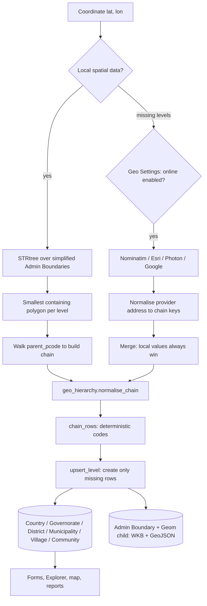

# Global administrative hierarchy (foundational geography pillar)

SIRAJ treats geography as a first-class index, not as free text. Every place,
person, institution and event can be anchored to the same six-level chain:

```
Country → Governorate → District → Municipality → Village → Community
```

The chain is deliberately uniform even though source countries are not. "Governorate"
covers `emirate`, `region`, `state`, `province`, `parish`, `prefecture`, etc. via
`admin_level_type`; a country that has no district level simply leaves that link
empty. **We never invent placeholder rows just to make a chain look deep.**

## 1. Architecture at a glance



### 1.1 DocType responsibilities

| Layer | DocType(s) | Responsibility |
|---|---|---|
| Editable hierarchy | `Country` (Frappe native), `Governorate`, `District`, `Municipality`, `Village`, `Community` | Human-readable bilingual labels, manual corrections, links to parent levels. |
| Canonical geometry | `Admin Boundary` + child `Admin Boundary Geom` | Full and simplified WKB, optional GeoJSON copy, numeric bbox, P-Code, parent P-Code, source dataset. |
| Point gazetteer | `Gazetteer Place` | GeoNames/OSM points; nearest-settlement fallback with distance and bearing. |
| Provenance / batches | `Boundary Dataset`, `Geo Settings` | Source licence, active dataset, simplification tolerance, import progress, online provider settings. |
| Resolution bridge | `siraj_research.geo_hierarchy` | Converts resolver payloads to linked DocType rows; safe upserts. |
| External fallback | `siraj_research.geo_online` | Cached, throttled reverse geocoding with four providers. |
| Bulk loaders | `siraj_research.geo_bulk`, `siraj_research.geo_import` | Streaming GADM/GeoNames/OSM imports with bounded memory. |

### 1.2 Fields added to each editable level

All five app-owned levels (`Governorate` … `Community`) now carry:

| Field | Type | Purpose |
|---|---|---|
| `pcode` | Data | Stable source identifier (GADM/GeoNames/OSM). Indexed. |
| `parent_pcode` | Data | Source parent identifier; complements the Frappe `Link`. |
| `admin_level_type` | Data | Local terminology: `emirate`, `parish`, `mahallah`, … |
| `latitude`, `longitude` | Float | Center point for maps and fast sorting. |
| `bbox` | Data | `west,south,east,north` string for display and quick checks. |
| `boundary` | Link → `Admin Boundary` | Full-resolution polygon. |
| `geojson` | Long Text | Simplified polygon for offline display; regenerable. |
| `source_dataset` | Link → `Boundary Dataset` | Import provenance. |
| `source_kind` | Select | `Manual`, `Imported`, `Online`, `Verified`, `Disputed`. |
| `last_verified_on` | Date | Manual review date. |

`Country` is a Frappe-owned DocType, so we do not patch its JSON. Its geometry
is stored as an `Admin Boundary` row at `level = 0` and joined through
`Country.code`. `Admin Boundary.linked_hierarchy_doctype` +
`linked_hierarchy` are Dynamic Links that connect a polygon back to any level,
including a Country.

`Admin Boundary` also has indexed `bbox_min_lon`, `bbox_min_lat`,
`bbox_max_lon`, `bbox_max_lat` fields. They let us pre-filter candidate
polygons in SQL before building an STRtree, which keeps worker memory flat.

### 1.3 Handling missing intermediate levels

`geo_hierarchy.normalise_chain()` maps resolver keys onto the six levels and
returns `(entries, gaps)`. A gap is reported with a reason; no synthetic row is
created. `chain_rows()` links only the levels that actually exist. Example:
a country with `country → governorate → municipality` produces a Municipality
whose `country` and `governorate` Links are set while `district` stays empty.
Manual researchers can later add a District and re-link children without a
migration.

Gazetteer points are only used as a **low-confidence village** when no
polygon-derived village/community exists. Set
`Geo Settings.link_gazetteer_as_village = 0` to disable that behaviour.

## 2. Reverse geocoding

### 2.1 Local first

`api.geo_resolve._resolve_one(lat, lon)`:

1. Validates ranges and flags `(0, 0)`.
2. Queries a per-worker `STRtree` cache keyed by
   `(dataset, index_version, precision)`.
3. Picks the smallest-area containing polygon at every level and walks
   `parent_pcode` upward.
4. Detects border ambiguity (two polygons at the same level, or a near miss
   within `border_tolerance_m`) and sea/gap cases.
5. Adds the nearest Gazetteer Place within `reverse_max_distance_m` with
   haversine distance and initial bearing.

The browser uses the same chain contract through `siraj-geo-worker.js`, fed by
the compressed offline package from `api.geo_package.current`.

### 2.2 External fallback

`api.geo_resolve.resolve_point(latitude, longitude, use_online=1)` calls
`geo_online.lookup()` only when `Geo Settings.online_geocoder_enabled` is on
and `online_fallback_when` is satisfied (`Missing country`, `Missing any level`,
or `Always`). Providers:

| Provider | Config key | Notes |
|---|---|---|
| Nominatim (OpenStreetMap) | no key | Must set `online_user_agent` with a contact address. |
| Esri World Geocoding | `online_api_key` (token) | `CountryCode`, `Region`, `Subregion`, `City` mapping. |
| Photon (Komoot) | no key | Uses first GeoJSON feature's `properties`. |
| Google Geocoding | `online_api_key` | Address-component types mapped to levels. |

Results are cached for `online_cache_days` via `frappe.cache()` and throttled
with both `online_rate_limit_per_min` and `online_min_interval_s`. Network
errors never break a local resolve; they add `online_fallback_failed` to
`warnings`.

`_merge_online()` only fills **missing** levels or missing P-Codes. Local
polygon values keep `confidence = high`; online values are labelled
`medium`.

### 2.3 Automatic creation and linking

```python
from siraj_research.geo_hierarchy import resolve_and_link

result = resolve_and_link(33.5138, 36.2765, create_missing=True, use_online=True)
print(result["hierarchy"])   # rows with status created/existing/missing
print(result["gaps"])        # levels with no source polygon
```

`link_resolved_chain()`:

- resolves the Country by ISO code or name (and creates it only if permitted);
- derives deterministic codes from source P-Codes (falling back to a hash of
  parent + slug when a dataset has no P-Code);
- inserts missing DocType rows with `source_kind = Imported`/`Online`;
- back-fills only *empty* spatial fields on existing rows — manual labels and
  descriptions are never overwritten;
- links each row to its `Admin Boundary` polygon and copies the bbox.

Whitelisted entry point for forms and import wizards:

```text
siraj_research.geo_hierarchy.resolve_and_link_point
  latitude, longitude, create_missing=1, use_online=0
```

## 3. Seeding strategy

### 3.1 Tier 1 — curated core (install-time, additive)

`bench --site SITE install-app siraj_research` runs
`siraj_research.setup.install.after_install`, which calls `seed_master_data()`:

- 249 countries from `setup/reference_data/countries.json`;
- 4,011 first-level units from `governorates.json` (200 countries);
- 1,411 districts from `districts.json`;
- sampled municipalities, villages and communities from `admin_units.json`.

All rows are bilingual (English + Arabic), get stable codes and are tagged
with `SIRAJ-REFERENCE` as their `Boundary Dataset` (recorded at level 0 even though the batch spans all levels). Rerunning is safe:
existing rows with a conflicting parent are skipped, never overwritten.

To refresh without reinstalling:

```bash
bench --site SITE execute siraj_research.geo_bulk.import_reference_hierarchy
```

### 3.2 Tier 2 — global polygons (background, chunked)

Create a `Boundary Dataset`, upload a GADM/geoBoundaries/OSM layer, then:

```bash
bench --site SITE execute siraj_research.geo_bulk.import_gadm \
  --kwargs '{"dataset_code":"GADM-ADM1","file_path":"/path/gadm41_ADM1.gpkg","level":1}'
```

`geo_import.import_boundary_job()` streams features in batches
(`Boundary Dataset.import_batch_size`, default 500), reprojects to EPSG:4326,
repairs invalid polygons with `make_valid`, writes full + simplified WKB and
(optionally) GeoJSON, commits per batch, records `last_processed_offset`, and
finally bumps `index_version` to invalidate resolver caches. Lower the batch
size on small workers; there is no all-features-in-memory step.

OSM PBF needs a one-time preparation step:

```bash
bench --site SITE execute siraj_research.geo_bulk.prepare_osm \
  --kwargs '{"input_path":"/data/nl-latest.osm.pbf","output_dir":"/data/osm","run":true}'
bench --site SITE execute siraj_research.geo_bulk.import_osm \
  --kwargs '{"dataset_code":"OSM-NL-ADM2","file_path":"/data/osm/nl-latest-boundaries.geojson","level":2}'
```

`prepare_osm(..., run=False)` prints the exact `osmium` commands without
running them. ODbL attribution must remain visible in the UI.

### 3.3 Tier 3 — populated places

```bash
bench --site SITE execute siraj_research.geo_bulk.import_geonames \
  --kwargs '{"zip_path":"/data/cities15000.zip","dataset_code":"GEONAMES-CITIES","country_codes":["IQ","SY","LB"],"batch_size":1000}'
```

GeoNames lines are parsed one at a time from the zip; rows are inserted in
bounded batches with `frappe.db.bulk_insert`. Set the active gazetteer dataset
in `Geo Settings` to use them for nearest-place resolution.

### 3.4 Tier 4 — link coordinates in bulk

```python
from siraj_research.geo_bulk import link_coordinates
link_coordinates([[33.51, 36.27], [34.02, -6.85]], create_missing=True,
                  use_online=True, batch_size=50)
```

### 3.5 Activate a dataset

In `Geo Settings` set `active_boundary_dataset` and
`active_gazetteer_dataset`, then call:

```text
siraj_research.api.geo_resolve.invalidate_cache
```

The client package is ETag-keyed on `index_version`, so browsers refetch only
after a completed import.

## 3.6 Completing the chain to the final local level

The curated reference layer is intentionally a *starter index*: it is complete
at country and level 1, partial at level 2, and sampled at levels 3–5. No
single open dataset has uniform six-level coverage worldwide, so the final
levels are filled by combining three sources in this order:

1. **GADM polygons (levels 1–5)** — authoritative administrative boundaries
   where published. Import each level as its own dataset:

   ```bash
   for L in 1 2 3 4 5; do
     bench --site SITE execute siraj_research.geo_bulk.import_gadm \
       --kwargs "{\"dataset_code\":\"GADM-ADM$L\",\"file_path\":\"/data/gadm/ADM$L.gpkg\",\"level\":$L}"
   done
   ```

2. **GeoNames admin codes + ADM3/4/5 features** — fills names where GADM does
   not publish a polygon for a level:

   The importer accepts either a zip **or a plain directory** of GeoNames
   `*.txt` files, so `zip`/`unzip` are not required. Put the three files in a
   writable directory. If the downloads landed in `~/frappe-bench`:

   ```bash
   mkdir -p ~/frappe-bench/geodata/geonames
   cd ~/frappe-bench/geodata/geonames
   mv ~/frappe-bench/allCountries.zip .
   mv ~/frappe-bench/admin1CodesASCII.txt ~/frappe-bench/admin2Codes.txt .

   # Extract allCountries.txt with Python (needs ~1.6 GB free disk).
   ~/frappe-bench/env/bin/python - <<'PY'
   import shutil, zipfile
   with zipfile.ZipFile("allCountries.zip") as zf:
       name = next(n for n in zf.namelist() if n.lower().startswith("allcountries"))
       with zf.open(name) as src, open("allCountries.txt", "wb") as dst:
           shutil.copyfileobj(src, dst)
   PY
   ```

   Then test one country synchronously:

   ```bash
   bench --site SITE execute siraj_research.geo_bulk.import_geonames_admin \
     --kwargs '{"zip_path":"/home/frappe/frappe-bench/geodata/geonames","country_codes":["IQ"]}'
   ```

   And queue the global run once the test looks right:

   ```bash
   bench --site SITE execute siraj_research.geo_bulk.enqueue_geonames_admin \
     --kwargs '{"zip_path":"/home/frappe/frappe-bench/geodata/geonames","dataset_code":"GEONAMES-ADMIN"}'
   ```

   The importer streams those three files and creates levels 1–5. When a
   higher code is blank, it builds the deepest available code chain and
   attaches the row to the deepest existing ancestor instead of dropping it.
   The skipped intermediate Link stays empty — no fake row is created. On
   District, Municipality, Village and Community the immediate parent Link is
   therefore optional; `parent_pcode` preserves the original source lineage.
   `label_ar` is mandatory, so imported rows get the English label as an
   Arabic placeholder until a researcher translates it on the form.

   The import result includes `admin_features_seen`, which tells you how many
   `ADM3`/`ADM4`/`ADM5` features the source actually contains for the selected
   countries. A level stays empty when the source has no feature for it.

   Check queued/failed datasets with:

   ```bash
   bench --site SITE execute siraj_research.geo_coverage.import_status_report
   ```

   If `bench restart` is interrupted, run it again before expecting queued
   jobs to start. Requeueing a polygon dataset clears its old failure log.
   Paths inside `--kwargs` must be absolute: `~` is not expanded there.

3. **OSM boundaries (neighbourhood / mahallah)** — OSM is the main open source
   for level-6 `community`. Map OSM `admin_level` like this:

   | OSM `admin_level` | SIRAJ level | DocType |
   |---|---|---|
   | 2 | 0 | Country |
   | 3–4 | 1 | Governorate |
   | 5–6 | 2 | District |
   | 7–8 | 3 | Municipality |
   | 9 | 4 | Village |
   | 10+ | 5 | Community |

   Prepare PBF data with `prepare_osm`, then import the resulting GeoJSON with
   `import_osm` using the mapped level. `bench --kwargs` is evaluated as
   Python, so booleans are `True` / `False`, not `true` / `false`:

   ```bash
   bench --site SITE execute siraj_research.geo_bulk.prepare_osm \
     --kwargs '{"input_path":"/home/frappe/frappe-bench/geodata/osm/netherlands-latest.osm.pbf","output_dir":"/home/frappe/frappe-bench/geodata/osm","run": True}'

   bench --site SITE execute siraj_research.geo_bulk.import_osm \
     --kwargs '{"dataset_code":"OSM-NL-COMMUNITY","file_path":"/home/frappe/frappe-bench/geodata/osm/netherlands-latest.osm-boundaries.geojson","level":5}'
   ```

   Note the output name contains `.osm-boundaries.geojson`; importing
   `...-boundaries.geojson` points at a file that does not exist.

   `prepare_osm` also requires the `osmium` binary (`sudo apt install osmium-tool`).
   Without it, call `prepare_osm(..., run=False)` and run the printed commands
   yourself, or import an already-prepared GeoJSON/GPKG directly.

### Troubleshooting pyogrio upgrades

`ValueError: too many values to unpack (expected 3)` during a boundary import
means pyogrio >= 0.7 was installed. The importer now accepts both the old
three-value `raw.read()` contract and the current four-value contract
`(meta, fids, geometry, fields)`. Re-run the failed dataset after updating.

### Polygon-to-hierarchy synchronisation

Importing polygons alone is not enough: `Admin Boundary` stores geometry, but
the editable hierarchy needs real DocType rows. Every GADM/OSM import now runs
`geo_hierarchy.sync_hierarchy_from_boundaries()` at the end of the same worker
job. That step:

- resolves `country` from OSM `ISO3166-1`/`ISO3166-2` tags or a single-code
  dataset name such as `OSM-IL-PS`;
- reads full/simplified WKB from the dataset;
- inherits `country` from the containing `admin_level=2` polygon when OSM
  child objects have no ISO tag;
- uses `parent_pcode` when the source supplies it;
- otherwise finds the smallest containing polygon at each lower level with an
  STRtree and links to that parent;
- creates missing `Governorate … Community` rows with deterministic codes,
  bilingual labels, bbox, center coordinates and a Link to the polygon;
- never overwrites a researcher's edits.

For an already-imported dataset, run it manually:

```bash
bench --site SITE execute siraj_research.geo_bulk.sync_boundary_hierarchy \
  --kwargs '{"dataset_code":"OSM-IL-COMMUNITY","levels":[5]}'
```

This is the mechanism that reaches the final `Community` level: GeoNames has
no ADM4/ADM5 features for Israel or Palestine, so OSM/GADM polygons are the
source of those rows.

For Israel and Palestine, prepare an OSM extract such as
`israel-and-palestine-latest.osm.pbf`, then:

```bash
bench --site SITE execute siraj_research.geo_bulk.prepare_osm \
  --kwargs '{"input_path":"/home/frappe/frappe-bench/geodata/osm/israel-and-palestine-latest.osm.pbf","output_dir":"/home/frappe/frappe-bench/geodata/osm","run": True}'

# Level 5 = Community / neighbourhood.
bench --site SITE execute siraj_research.geo_bulk.import_osm \
  --kwargs '{"dataset_code":"OSM-IL-PS-COMMUNITY","file_path":"/home/frappe/frappe-bench/geodata/osm/israel-and-palestine-latest.osm-boundaries.geojson","level":5}'
```

`import_osm` now syncs automatically and reads each feature's OSM
`admin_level`, mapping 2→Country, 3–4→Governorate, 5–6→District, 7–8→
Municipality, 9→Village and 10+→Community. A single import of the prepared
GeoJSON therefore materialises every level present in the file, including the
final `Community` rows; the `level` argument is only the dataset default.

### Coverage report

Run this after each import to see exactly which countries still need work:

```bash
bench --site SITE execute siraj_research.geo_coverage.coverage_report
bench --site SITE execute siraj_research.geo_coverage.coverage_report --kwargs '{"country":"IQ"}'
bench --site SITE execute siraj_research.geo_coverage.missing_final_levels
```

The report returns row counts per level, countries without any village or
community, and countries that already have a complete chain. A full global
chain is a *target state*, not a precondition for using the app: partial
countries remain searchable and gaps are reported by the resolver.

### Code normalisation

Datasets disagree on P-Code punctuation (`IQ.BG` vs `IQ-BG`). `make_code()`
now normalises dots and spaces to dashes, and `upsert_level()` searches by
exact code, normalised code, `pcode + parent`, and `label_en + parent` before
inserting. Re-importing the same area therefore updates rather than
duplicates it.

## 4. Manual corrections and modern changes

1. Open the level's DocType (e.g. `District`) and edit the bilingual label,
   `admin_level_type`, center or parent Link.
2. Set `source_kind = Verified` and `last_verified_on`.
3. If an administrative map changed, upload a new `Boundary Dataset` and
   activate it. The old dataset stays available for audit; the editable row
   keeps pointing at the newest polygon through `boundary`.
4. Disputed claims can be marked `source_kind = Disputed` rather than deleted.
   The resolver still returns them but flags `ambiguous`.

Imported values are never overwritten by later imports of the same data:
`upsert_level()` only fills fields that are currently empty.

## 5. Tests and verification

Workspace (no bench needed):

```bash
PYTHONPATH=. /tmp/siraj-venv/bin/python -m pytest \
  tests/test_geo_hierarchy.py tests/test_geo_online.py \
  tests/test_geo_bulk.py tests/test_geo_coverage.py \
  tests/test_geo_upsert_mandatory.py tests/test_master_data_dataset.py -q
/tmp/siraj-venv/bin/ruff check siraj_research/geo_hierarchy.py siraj_research/geo_online.py \
  siraj_research/geo_bulk.py siraj_research/geo_import.py \
  siraj_research/api/geo_resolve.py siraj_research/setup/master_data.py
node --check siraj_research/public/js/siraj-geo-worker.js
git diff --check
```

On a bench (replace `SITE`):

```bash
cd ~/frappe-bench
./env/bin/python -m pytest apps/siraj_research/tests/test_geo_hierarchy.py \
  apps/siraj_research/tests/test_geo_online.py \
  apps/siraj_research/tests/test_geo_bulk.py \
  apps/siraj_research/tests/test_geo_coverage.py \
  apps/siraj_research/tests/test_geo_upsert_mandatory.py \
  apps/siraj_research/tests/test_master_data_dataset.py -q
./env/bin/ruff check apps/siraj_research/siraj_research/geo_*.py
bench --site SITE migrate
bench --site SITE clear-cache
bench restart
bench --site SITE console
```

Smoke checks in `bench console`:

```python
from siraj_research.api.geo_resolve import resolve_point
from siraj_research.geo_hierarchy import resolve_and_link, ancestors
r = resolve_point(33.5138, 36.2765, use_online=0)
print(r["admin_chain"], r["warnings"])
linked = resolve_and_link(33.5138, 36.2765, create_missing=False)
print(linked["hierarchy"], linked["gaps"])
print(ancestors("Community", "<a community name>"))
```

## 6. Dependencies

```bash
./env/bin/pip install shapely pyproj pyogrio requests
```

`shapely`, `pyproj` and `pyogrio`/`fiona` are optional at import time so the
app can be installed on a minimal bench; polygon imports and server-side
resolution return a clear "install packages" message when they are missing.
The offline browser resolver needs no Python packages.
